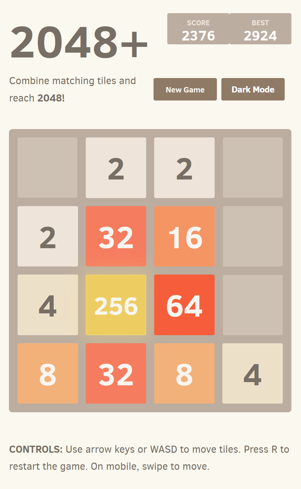
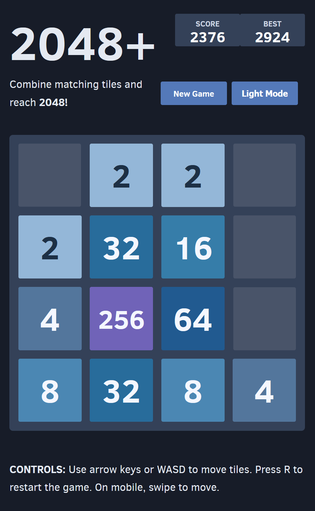

# 2048 (React + Vite)

## 1. Project Overview

A modern React + Vite implementation of the classic **2048** game, migrated from the original vanilla JavaScript structure while preserving its familiar gameplay and visual style.

## 2. Reason for Selection

I selected this project because it is a React version of a classic game. The original project also supports customization, and its README provides tips for modifying the game.

## 3. Original Repository

https://github.com/radhey004/2048-1.git

### License

This project includes the original 2048 MIT license text in `LICENSE.txt`.

## 4. Installation and Execution

1. Install dependencies:

   `npm install`

2. Start the local development server:

   `npm run dev`

3. Open the URL displayed in the terminal (usually `http://localhost:5173`).

### Available Scripts

- `npm run dev` — Starts the Vite development server with fast refresh.
- `npm run build` — Builds the application for production in the `dist/` directory.
- `npm run preview` — Runs a local server to preview the production build.

## 5. Core Files

- **`main.jsx`** — Initializes and starts the React application.
- **`App.jsx`** — Manages game state, handles user input, and renders the UI.
- **`game.js`** — Implements the core game logic, including tile movement, merging, and win/loss detection.

## 6. React Component and State Management

The game follows this process when the player presses a movement key:

`App.jsx` detects keyboard input → `game.js` calculates the updated board → `setGame()` updates the React state → React re-renders the game interface.

This allows the game interface to update automatically whenever the game state changes.

## 7. Code Analysis

The `useEffect()` hook in lines 89–112 of `App.jsx` handles keyboard controls.

The following object maps keyboard inputs to numeric directions:

```javascript
const KEY_TO_DIRECTION = {
  ArrowUp: 0,
  ArrowRight: 1,
  ArrowDown: 2,
  ArrowLeft: 3,
  w: 0,
  d: 1,
  s: 2,
  a: 3,
};
```

When the user presses a key, the following code converts the input into a numeric direction:

```javascript
const direction = KEY_TO_DIRECTION[key];
```

The game state is then updated using:

```javascript
setGame((current) => moveGame(current, direction));
```

- `current` represents the current game state passed by React to the state updater function.
- `moveGame(current, direction)` calculates the new game state based on the current board and movement direction.
- `setGame()` updates the React state with the calculated result.

After the state is updated, React automatically re-renders the game interface.

## 8. Customizations

I made the following modifications to the original project:

1. Changed the page title, game description, and gameplay instructions.
2. Added a dark mode toggle, and slightly adjusted the page layout to accommodate the new dark mode button.
3. Implemented saving color theme preferences using `localStorage`.

Mainly two files were modified: `src/App.jsx` and `style/main.css`.

### Light Mode vs. Dark Mode

| Light Mode | Dark Mode |
|---|---|
|  |  |

## 9. Vercel Deployment

The customized game is deployed on Vercel.

https://2048-1-dun.vercel.app/

## 10. Weekly Review

### Three Things I Learned

1. The basics of Node.js and its role in web development.
2. How React components and state management work.
3. How to run a local development server using npm and deploy a web application.

### Challenges and Solutions

Understanding the structure and functionality of an existing project took some time. I also needed time to get used to JSX, which combines JavaScript logic with HTML-like syntax.

Using AI tools to break down the project into smaller sections helped me understand each part more easily.

### AI Usage and Reflection

I used AI tools to analyze the project structure and suggest three customization options with increasing levels of difficulty.

Through this project, I found that modifying an existing project can be more challenging than expected because I first need to understand its structure and how different parts of the code work together.

I realized that I need more practice reading, understanding, and modifying existing code.